# Bloom

Android app for creating, completing and reviewing personal habits. The UI is Jetpack Compose with Material 3. Data follows Clean Architecture: the screen renders state, the ViewModel sends it, and repositories talk to Supabase and a local Room cache.

Habits are online-first. A write needs a network connection and lands in Supabase before Room is updated. Reads can use the cache already on the device.

The functional source of truth is [`spec.md`](spec.md).

## Screenshots

Sign in and create account.

<p>
  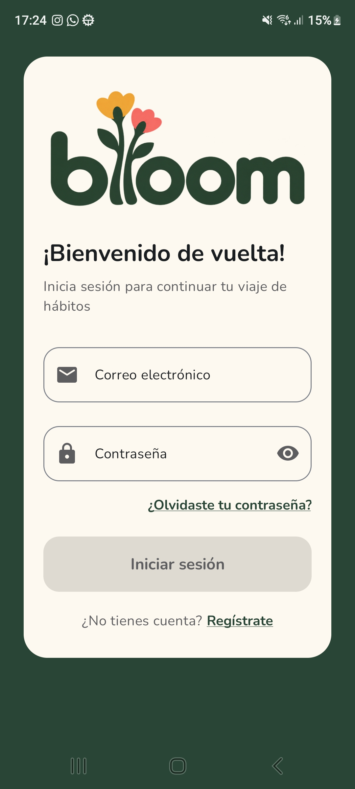
  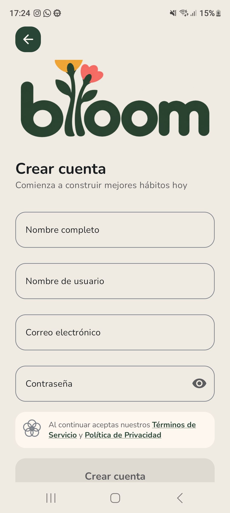
</p>

Home, a habit's detail and stats.

<p>
  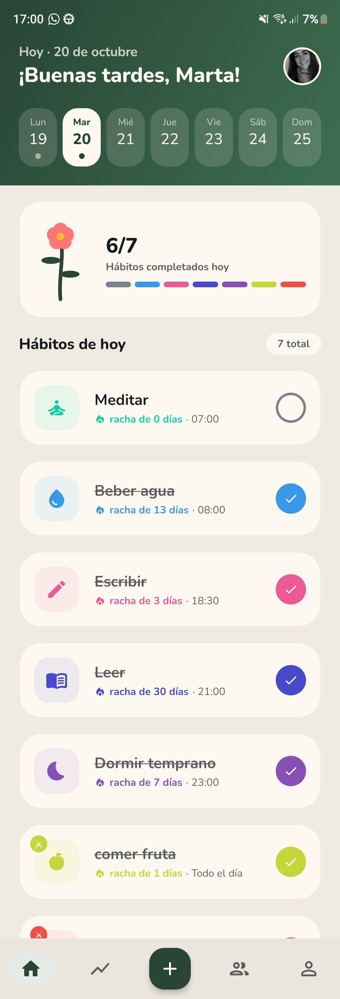
  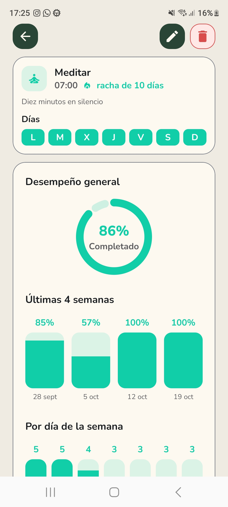
  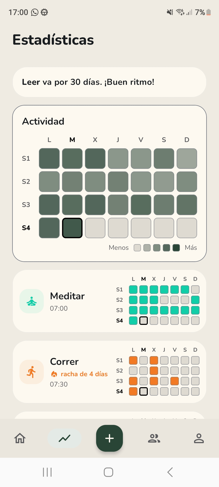
</p>

Home in dark mode.

<p>
  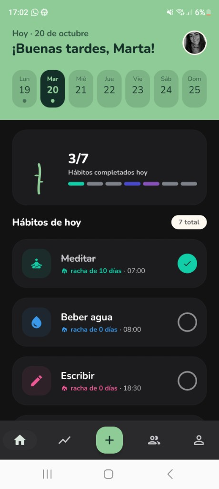
</p>

Creating a habit: icon, color, reminder and weekdays.

<p>
  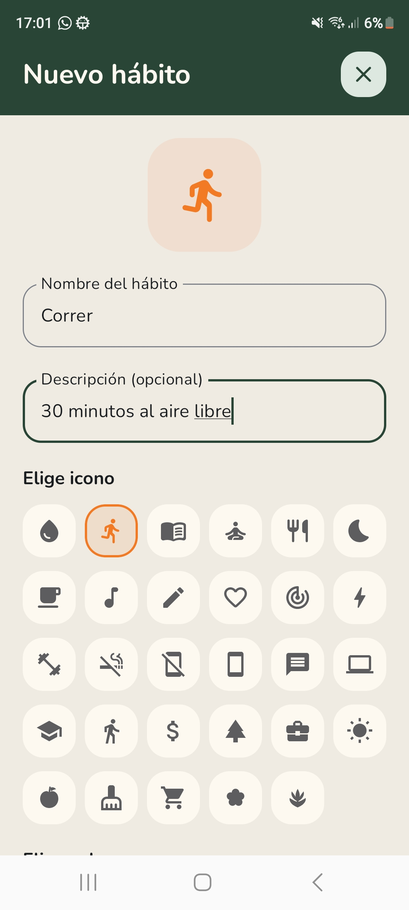
  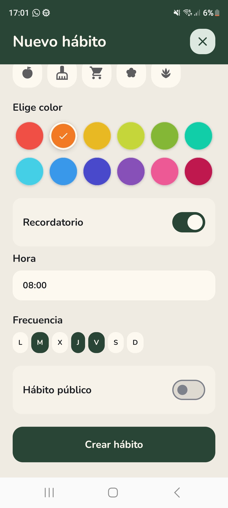
</p>

Friends, active challenges and the sheet to create one.

<p>
  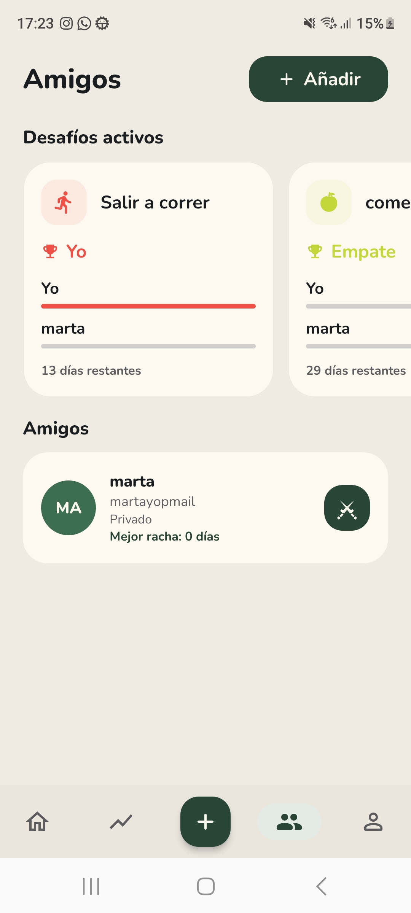
  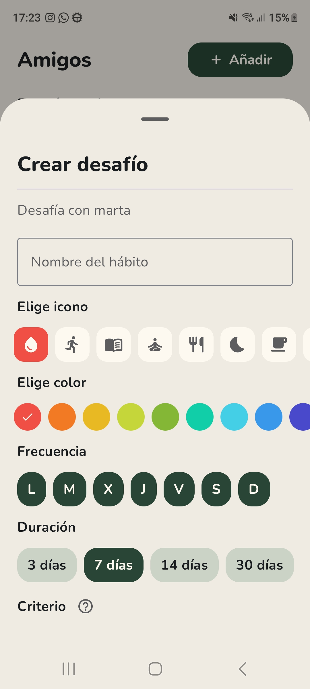
</p>

Assistant chat. From Statistics, someone with habits can ask about their week. Each message goes out with the current Monday–Sunday counts, and the reply can use those numbers without adding others. The thread stays on screen until you leave it.

<p>
  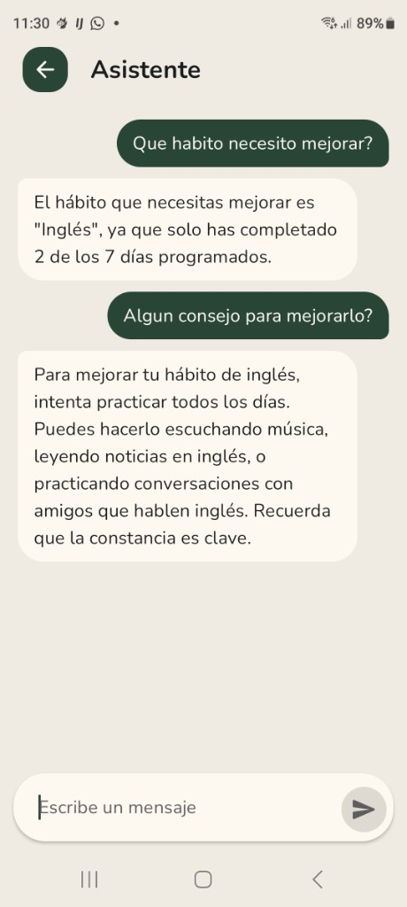
</p>

Today's habits on the home screen.

<p>
  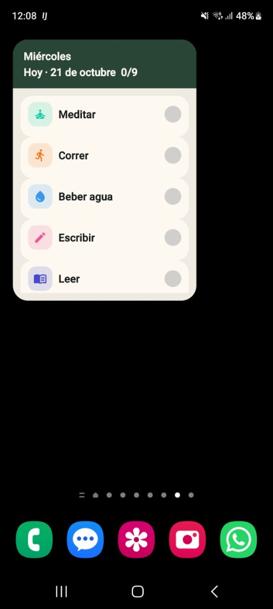
</p>

## Features

### Authentication
- Email and password sign-in, registration and a persisted session
- First launch opens an onboarding flow, then login or home
- Registration password stays in error until it has at least 8 characters, one letter and one number. The create-account button uses the same rule
- Sign-in still rejects weak passwords locally (length, upper case, lower case and a digit) before calling the network
- Forgot password sends a Supabase reset email. The link `habittracker://auth/reset` opens the app so the user can set a new password

### Habits
- Create, edit and delete a habit with name, optional description, icon, color and weekdays
- Each habit is private unless the user marks it public
- Mark a habit complete or incomplete for a day, with current and longest streaks
- Optional local reminder at a chosen time, only on the habit's weekdays. It is off by default
- Home lists habits for the selected date. Detail shows history and a calendar heatmap

### Stats and profile
- Stats shows a four-week activity heatmap, the busiest weekday and the longest live streak
- Profile shows the display name, avatar, day streak, completed records and habit count
- Weekly goal: five qualifying days in the current Monday–Sunday week
- Preferences edits the display name and gallery avatar, and can delete the account after the user types `DELETE`

### Social
- Search people, send and answer friend requests, and see a friend's public habits
- Challenge a friend and open the challenge detail
- Friends and challenges need a network connection. They are not cached in Room
- Push notifications when someone creates a challenge or sends a friend request

### Home screen widgets
Four Glance widgets:
- One habit, with a toggle for today
- One challenge, read-only, from the last snapshot
- Weekly summary of scheduled habits
- Today's habits (up to five rows)

### AI-powered suggestions based on your habits.

```
presentation → domain ← data
```

- **presentation** — Compose screens split into `*Screen` (ViewModel and navigation) and `*Content` (state and callbacks). ViewModels expose `StateFlow`. One-shot events use a buffered `Channel` and `ObserveAsEvents`.
- **domain** — use cases, validators and repository contracts. No Android framework types.
- **data** — Room, DataStore and Supabase. Entities and DTOs stay in this layer.

## Tech stack

| Area             | Choice                                                                 |
| ---------------- | ---------------------------------------------------------------------- |
| UI               | Jetpack Compose, Material 3, Navigation Compose, Coil                  |
| State            | Kotlin Coroutines, `Flow`, `StateFlow`                                 |
| DI               | Hilt                                                                   |
| Local            | Room, DataStore                                                        |
| Remote           | Supabase Auth, PostgREST, Storage and Edge Functions, via Ktor         |
| AI               | Ollama for AI-powered habit suggestions, with a Python FastAPI backend |
| Background       | WorkManager for widget refresh, `AlarmManager` for habit reminders     |
| Widgets          | Jetpack Glance                                                         |
| Push and crashes | Firebase Cloud Messaging, Analytics and Crashlytics                    |
| Tests            | JUnit, Robolectric, `kotlinx-coroutines-test`, Espresso, Kover         |


`minSdk` is 26 and `targetSdk` is 36. CI uses JDK 17.

## Project structure

```
app/src/main/java/com/marta/habittracker/
├── presentation/    # screens, navigation, widgets, theme
├── domain/
├── data/
├── core/            # reminders, push, ids
└── di/
```

## Run it locally

1. Put the Supabase values in `local.properties` (this file is gitignored):

   ```properties
   SUPABASE_URL=https://your-project.supabase.co
   SUPABASE_PUBLISHABLE_KEY=your-publishable-key
   ```

2. Place the Firebase Android config at `app/google-services.json` so Messaging and Crashlytics can start. Crash reports must not include passwords or tokens.
3. In the Supabase dashboard, set Site URL and Redirect URLs to include `habittracker://auth/reset` and `habittracker://auth/confirm`. Leave Site URL off `http://localhost:3000`, or the confirmation email opens a blank page.
4. Build and install a debug APK:

   ```bash
   ./gradlew :app:assembleDebug
   ```

Unit tests:

```bash
./gradlew :app:testDebugUnitTest
```

## Out of scope

- Google or other social sign-in
- Dynamic color
- Writing habits while offline
- Completing a habit from the reminder notification
- A global notifications screen in Profile
